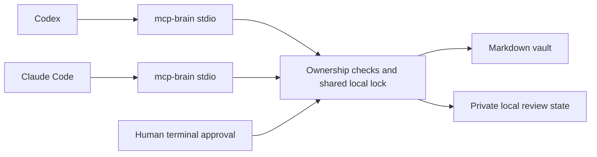

# Ownership, privacy, and design limits

## Why an MCP server

A home-directory instruction file helps one assistant remember a convention.
MCP makes the same memory operations available to multiple clients. The server
loads its policy whenever a tool runs, so preservation does not depend on the
model rereading instructions correctly.

The vault remains ordinary Markdown. There is no private database format to
export, no embedding service to operate, and no model credential in the server.
Obsidian is a compatible editor, not a required runtime.

## Memory is a layer over notes

Reference notes and durable memory serve different purposes. A draft or human
question should not automatically become a fact about the user. Dedicated
memory tools create explicit records with stable IDs, types, scopes, provenance,
review dates, and an active/archived lifecycle. They use the same ownership and
revision checks as the note tools.

All memory data and previous versions live in Markdown, so copying the notes to
another machine or connecting another provider preserves the memory. There is
no provider-specific store to migrate. The local state directory is used for
review plans, policy, reminders, recovery, and a rebuildable index; Markdown remains the source of truth.

Recall selects current content and keeps old versions out of its search corpus.
Global and project scopes reduce irrelevant context; they are not access-control
boundaries. Any client with these tools can explicitly request every scope.
Sources and evidence categories are supplied by the caller and cannot establish
truth by themselves. Semantic contradictions require the assistant and user to
resolve them with an update or archive operation.

The server does not read or synchronize a provider's built-in memory. Importing
that material requires an explicit user-controlled export and review. A client
must still call recall for the shared memory to influence its answer.

## Enforced ownership

Authorship belongs in the note, rather than a model-specific instruction file.
Only the exact YAML scalar `author: ai` permits body replacement. Missing,
unknown, or non-string author values are treated as human. Malformed or
duplicate frontmatter is rejected for editing.

For human notes, only the explicitly marked trailing AI section is editable.
Creating that section is an append. Revising it preserves all prior bytes.
Adding a missing `up` field is an additive frontmatter operation; existing human
YAML is not reserialized. Conflicting human parent metadata blocks a move.

AI notes can be rewritten, but their trailing `## Notes` belongs to the human.
The server parses actual Markdown headings and preserves that suffix verbatim.
Code examples, quoted headings, and list content do not grant edit authority.
It also parses the result to reject content that would hide the protected
section inside an unclosed code fence or HTML block.

Existing ownership labels and markers are trusted declarations by the vault's
owner. If another writer changes `author: human` to `author: ai`, the server has
no historical provenance system to detect that change. No MCP tool can change
the author label.

## Scope of the boundary

The server constrains MCP operations. It does not sandbox the rest of a coding
agent, the operating system, or other programs running as the same user.

For stronger enforcement, expose only the MCP service to the agent and deny
the agent direct vault writes, direct access to local state, and shell commands
that can run approval operations. A local confirmation prompt prevents an
MCP-only caller from approving a plan; unrestricted terminal access bypasses
that separation.

Path checks reject common escapes and aliases. Cooperative mcp-brain clients
share a file lock, and content revisions reject stale edits. An unrelated
editor does not honor that lock. Content is checked again before replacement,
but a malicious local process can race filesystem checks. This implementation
does not claim to withstand hostile processes mutating the same directories.
Network filesystems and unusual locking semantics are not certified.

Individual note replacements use temporary files and atomic persistence.
Multi-file writes use a recovery journal and are not fully atomic. They do not
automatically undo completed writes after a later failure, because a rollback
could overwrite new human work. See the [recovery guide](inbox.md#recover-from-an-interrupted-write).

## Git synchronization and exact commits

A single coordinator serializes cooperative writes, watching, and synchronization.
Git vaults keep its lock in their Git metadata; plain folders keep it in local
state. All processes must still share the same state directory. An alternate
state path cannot bypass the Git lock but would hide pending journals and policy.

Strict mode backs up existing human work before changing notes. Offline mode
skips that initial push requirement, preserves local commits, and reports pending
uploads. A completed local commit and a successful remote backup are separate
states. A push failure does not imply the edit should be repeated.

AI commits build a temporary index from HEAD and write the planned text as Git
blobs. Later editor saves remain in the worktree. Independently staged content
is retained in the real index. Updating HEAD uses the expected old commit, and
an index lock excludes normal Git staging during this step. This avoids reading
new human text into an AI commit. It bypasses commit hooks and automatic signing;
human checkpoints still use ordinary Git commit. Custom clean filters on note
paths are unsupported. A crash between the HEAD and index updates can leave
staged differences requiring inspection; it does not roll back working files.

Sync fetches and fast-forwards a clean tree only. Remote revisions are trusted
Git content from the owner's configured upstream, not AI-authored rewrites.
Reading does not implicitly synchronize. Optional startup/interval sync and the
foreground watcher require local configuration. No external Git automation can
be made cooperative merely by installing this server.

## Retrieval and review

The local index stores word postings, metadata, and parsed memories. Every query
hashes the current Markdown files; only changed records are reparsed. Thus search
avoids repeatedly parsing and searching all text, but still reads the vault to
notice external edits. The index is rebuildable and contains private information.
It is neither an embedding store nor a database service. Unicode lowercase word
matching has no stemming, language model, or semantic truth assessment.

Recall limits the serialized `memories` array by characters, not model tokens.
An oversized record becomes an explicit reference instead of a silently cut
statement; pagination still advances. Metadata outside that array and the MCP
protocol representation are not included in the budget. Reference search can
match historical text, while recall indexes current memory statements only.

Optional source snapshots record vault-relative paths and content hashes in the
memory's frontmatter, so changed-source review works after copying the Markdown
to another machine. A moved source becomes unavailable until a reviewed update
points to its new path. Review also flags overdue records and lexical overlaps
or same-title candidates in overlapping scopes. These are proposals, not proof
of contradiction; compatible statements can share words. Review does not edit
notes. The user and assistant decide whether to update, postpone review, or
archive, with the reason retained by the existing memory tools.

## PARA is context, not automatic judgment

The server exposes the six known folders and the meaning of each category.
This lets assistants browse projects and responsibilities separately from
reference material. It does not pretend that a topic determines actionability.

Inbox review supplies lexical folder hints and questions. The assistant uses
the full note and the user's intent to propose destinations. The human reviews
the exact changes locally. Notes that could belong in two categories need a
conversation, not an automatic move.

New captures always enter Inbox. This version deliberately concentrates on
capture, retrieval, protected enrichment, and Inbox review. Folder renaming,
whole-project archiving, custom PARA names, semantic retrieval, and general
Obsidian link resolution are future work.

## Reminders need a delivery mechanism

The stdio process runs while its MCP client runs. It cannot reliably wake a user
at a time of day or force a client to open a conversation. The server therefore
records an opt-in review interval and exposes due status whenever asked.

A calendar export provides ordinary recurring alarms. An OS scheduler can call
the CLI for state-aware reminders. Neither is installed automatically, and the
MCP has no reminder-configuration tool.

## Privacy

mcp-brain itself makes no model API requests and sends no telemetry. Reads and
tool results pass to the configured MCP client, which may transmit that content
to its model provider. Local files do not make the assistant's entire workflow
local. Choose your client and provider accordingly.

Git-backed vaults use their existing upstream as a backup. The server cannot
verify whether that remote is private or appropriate for the stored material.
Verify it before enabling writes. It does not mirror notes to the mcp-brain
project repository or change repository visibility.

Plans, recovery journals, search indexes, and tool transcripts may contain note contents. Keep
the state directory and client logs private. There is no semantic detector that
can reliably tell personal data, client material, or secrets from ordinary prose.
The server supplies guidance, but deciding what may be retained remains a human
and client policy responsibility.

This public project contains only source code, documentation, and invented test
fixtures. Do not attach a real vault, credentials, client code, internal URLs,
or private transcripts to public issues. Use a minimal fictional reproduction.
